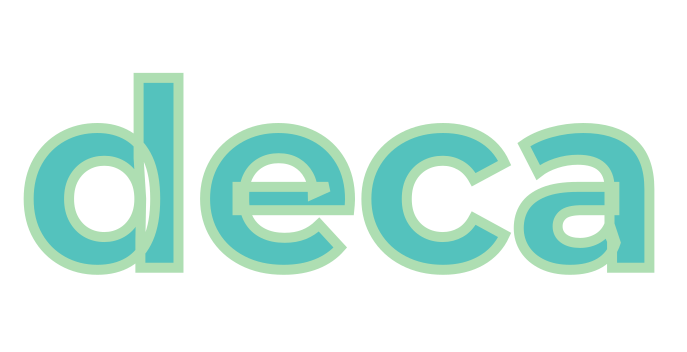

<div align="center">


<br>


</div>

<br>

`deca` is an immutable Linux distro based on [Fedora](https://fedoraproject.org)'s [Atomic Desktops](https://docs.fedoraproject.org/en-US/atomic-desktops) with the [Cinnamon](https://github.com/linuxmint/cinnamon) desktop environment.

<br>

All of `deca`'s code is kept in the [**run.yml**](.github/workflows/run.yml) workflow, including the faux-[containerfile](https://github.com/containers/common/blob/main/docs/Containerfile.5.md) **decaconf**. It pulls [fedora-bootc:latest](https://quay.io/fedora/fedora-bootc) and modifies it according to the **decaconf**, imports the files from [**/system**](system), rechunks the whole thing with [Chunkah](https://github.com/coreos/chunkah), and signs it with [Cosign](https://github.com/sigstore/cosign) before uploading it to GitHub's [Container Registry](https://github.blog/news-insights/product-news/introducing-github-container-registry).

<br>

You can [rebase](https://docs.fedoraproject.org/en-US/atomic-desktops/updates-upgrades-rollbacks/#rebasing) to `deca` from any existing [rpm-ostree](https://coreos.github.io/rpm-ostree) or [bootc](https://bootc.dev) system:

```
# Pin current deployment
sudo ostree admin pin 0

# Rebase with rpm-ostree:
rpm-ostree rebase ostree-unverified-registry:ghcr.io/calamityfox/deca
```
```
# Pin current deployment
sudo ostree admin pin 0

# Rebase with bootc:
bootc switch --enforce-container-sigpolicy ghcr.io/calamityfox/deca
```
<br>

<div align="center">

[](https://www.media.mit.edu/publications/your-brain-on-chatgpt)

</div>
